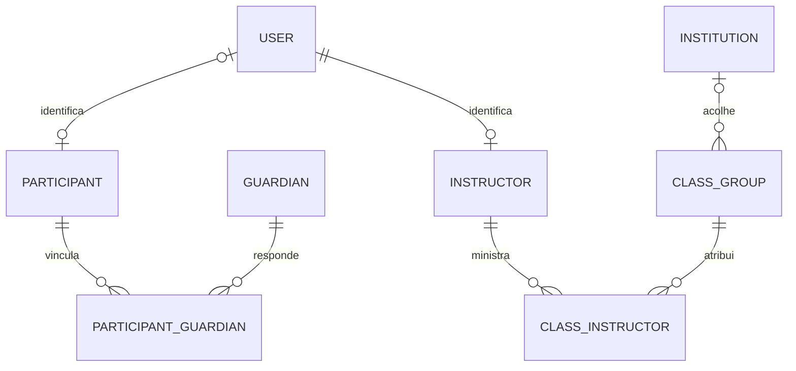
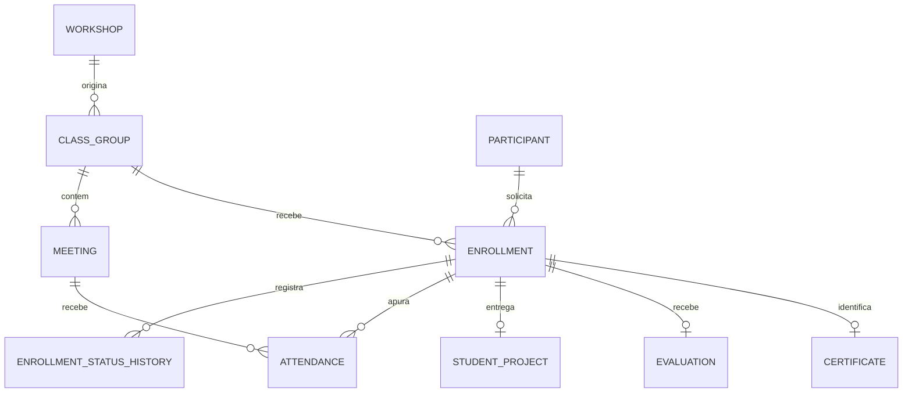
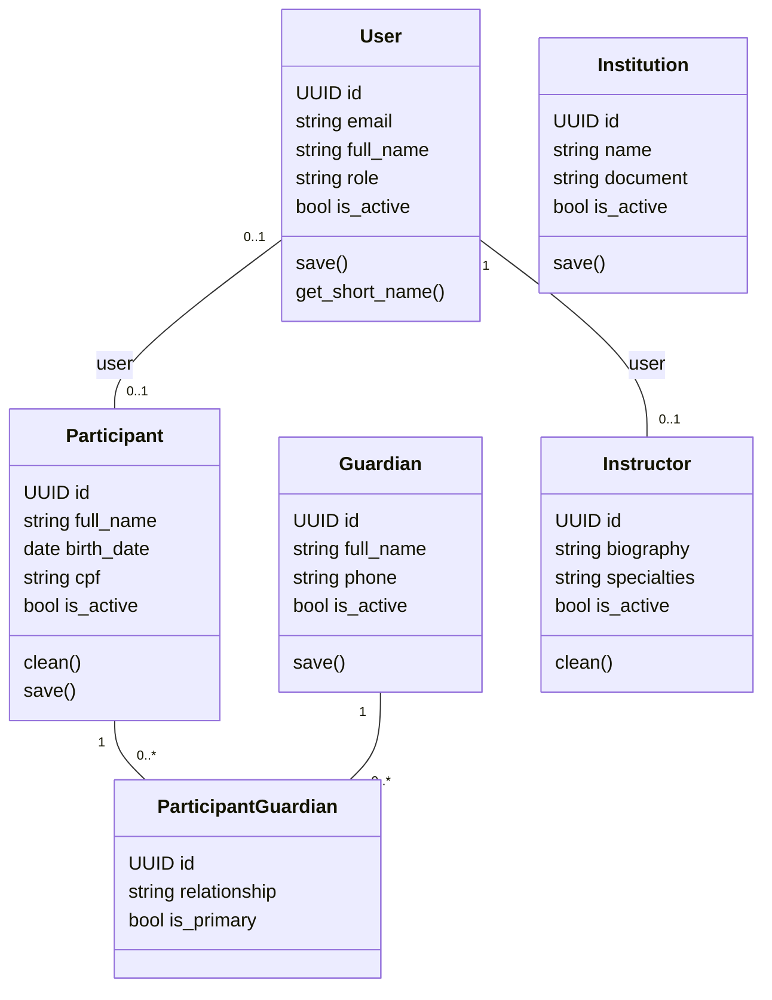
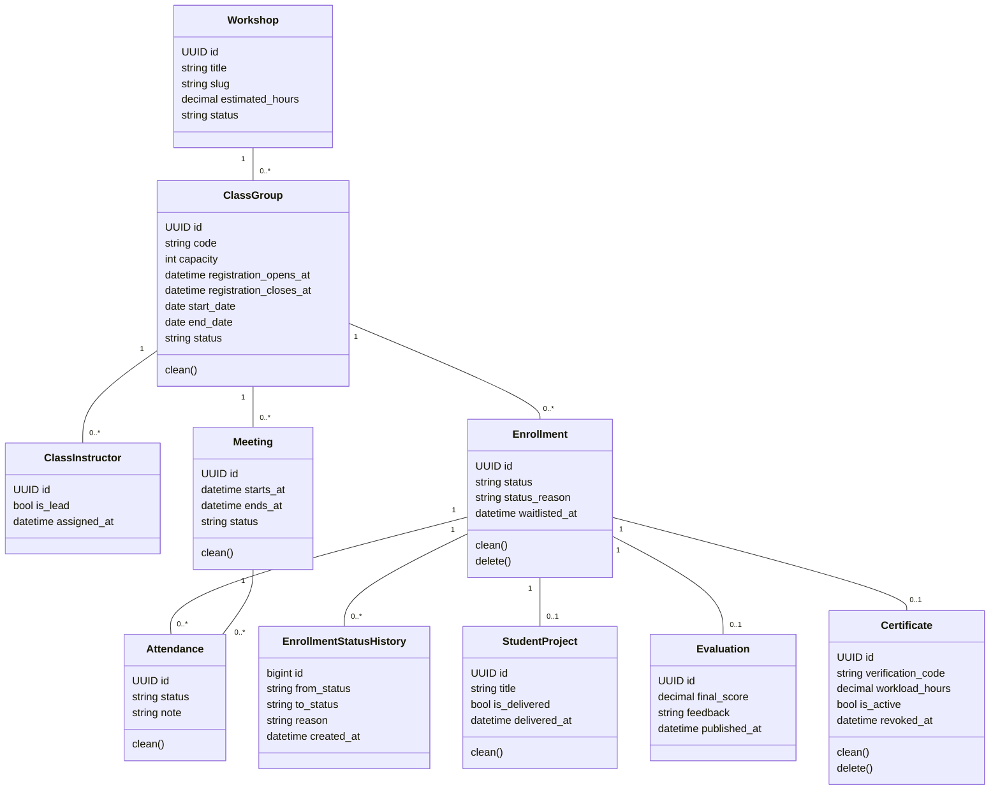
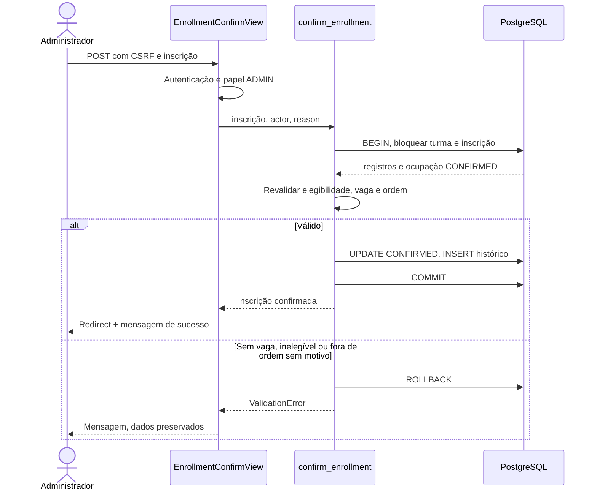
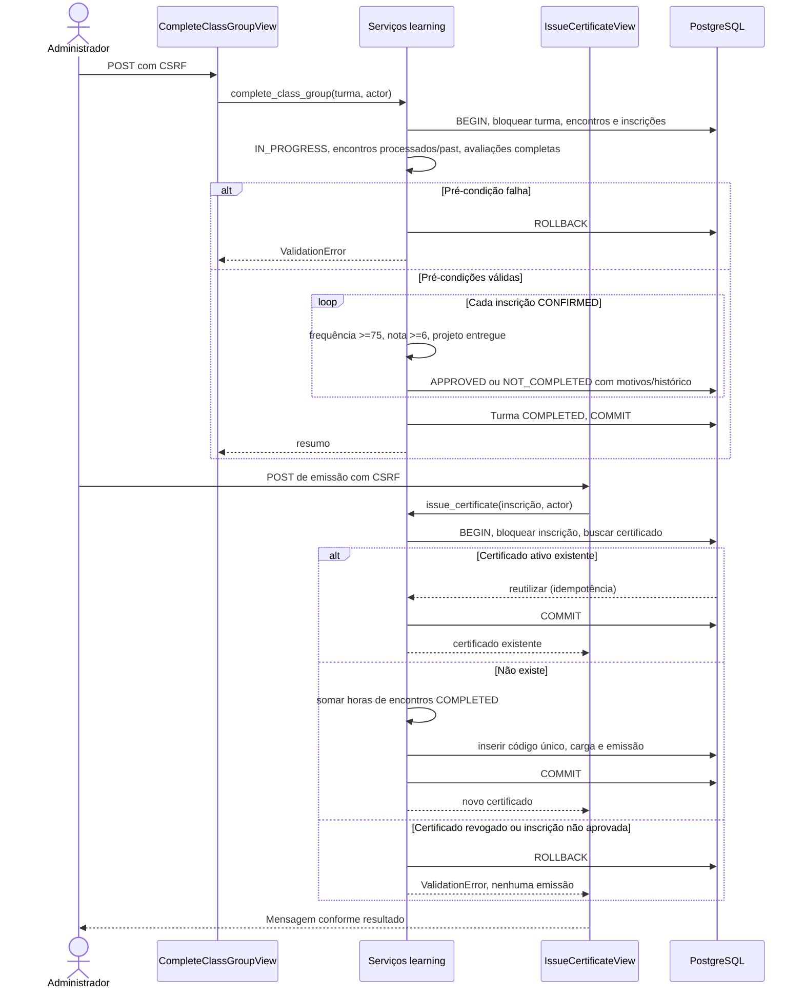
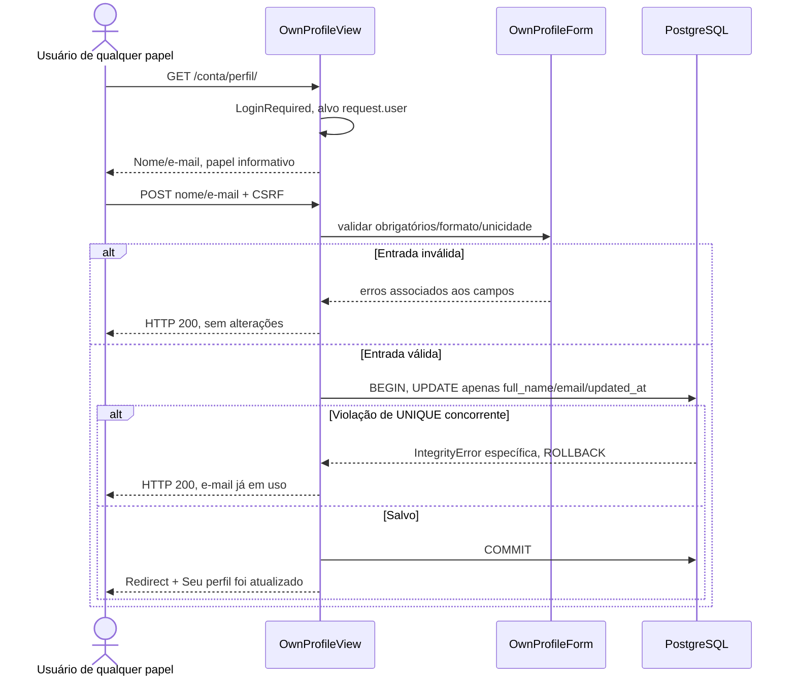
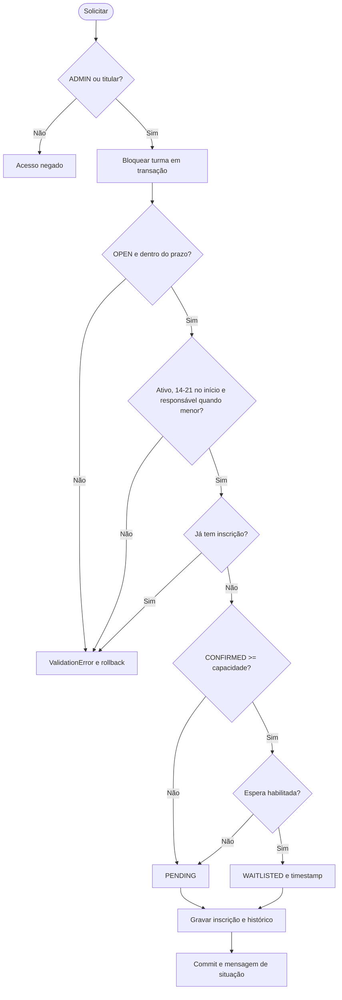
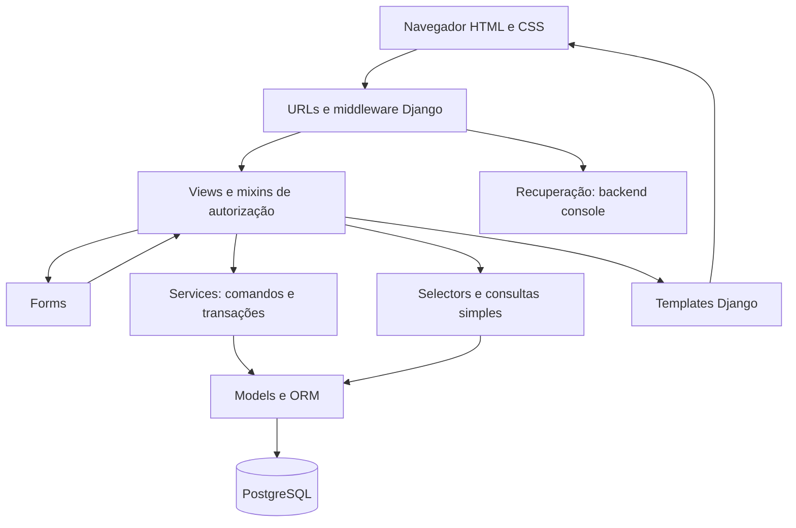

# Diagramas revisados da implementação

Referência: código a351c5a/develop 644e7a6. Fontes versionáveis `.mmd`, blocos Mermaid e SVGs locais. Classes e sequências usam notação UML suportada pelo Mermaid; DER e fluxogramas são identificados como tais. Não se apresenta fluxograma como diagrama formal UML de casos de uso. O catálogo UC e seu mapa de atores estão em [casos-de-uso.md](casos-de-uso.md).

A revisão compara com código atual e os diagramas registrados no Integrador II; o protótipo e os diagramas originais do Integrador I não foram encontrados. Classes mostram atributos/métodos selecionados, sem inventar métodos de serviço dentro dos models. Relações autorais, Participant/Instructor/Institution externos à jornada e todos os campos constam no [modelo lógico](modelo-logico.md)/[dicionário](dicionario-de-dados.md); os dois DERs devem ser lidos juntos.

## Conceitual — pessoas e atribuições

[Fonte](diagramas/conceitual-pessoas.mmd) · [SVG legível](diagramas/conceitual-pessoas.svg)

## Conceitual — jornada

[Fonte](diagramas/conceitual-jornada.mmd) · [SVG legível](diagramas/conceitual-jornada.svg)

## UML — classes de pessoas

[Fonte](diagramas/classes-pessoas.mmd) · [SVG legível](diagramas/classes-pessoas.svg)

## UML — classes acadêmicas

[Fonte](diagramas/classes-jornada.mmd) · [SVG legível](diagramas/classes-jornada.svg)

## UML — sequência de confirmação

[Fonte](diagramas/confirmacao.mmd) · [SVG legível](diagramas/confirmacao.svg)

## UML — sequência de conclusão e emissão

[Fonte](diagramas/conclusao-certificado.mmd) · [SVG legível](diagramas/conclusao-certificado.svg)

## UML — sequência do perfil próprio

[Fonte](diagramas/perfil-proprio.mmd) · [SVG legível](diagramas/perfil-proprio.svg)

## Atividade de inscrição (fluxograma)

[Fonte](diagramas/atividade-inscricao.mmd) · [SVG legível](diagramas/atividade-inscricao.svg)

## Componentes e camadas

[Fonte](diagramas/camadas.mmd) · [SVG legível](diagramas/camadas.svg)

## Conferência dos fluxos

- Confirmação: enrollments/services.py confirm_enrollment/_confirm_locked e views; bloqueia turma antes da inscrição, preserva histórico, falha sem exceder vaga.
- Conclusão: learning/services.py complete_class_group/issue_certificate; professor pode avaliar, somente ADMIN conclui/emite. Falha de pré-condições não grava resultado parcial. Um certificado revogado não pode ser reemitido.
- Perfil: accounts/views.py OwnProfileView, forms e tests/accounts/test_profile.py; alvo definido pela sessão, whitelist, UNIQUE e CSRF.
- Solicitação: create_enrollment; duplicidade gera erro, não devolve silenciosamente um registro existente. A espera não confirma automaticamente uma nova solicitação.

Qualquer mudança de estado/regra deve atualizar fontes e renderizações. Os SVGs foram renderizados localmente com mermaid-cli 12.0.0; não requerem serviços de terceiros para leitura.
