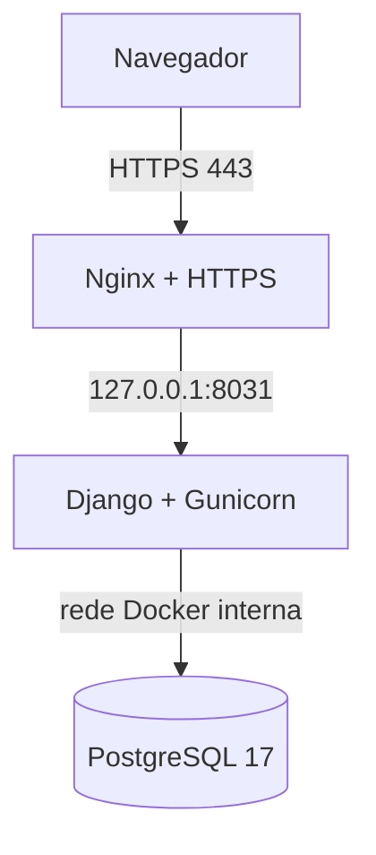

# Implantação na VPS

Este procedimento publica a release candidata em uma VPS Ubuntu usando Docker Compose,
PostgreSQL 17, Gunicorn, Nginx e HTTPS. O Nginx do host é a única entrada pública; a aplicação
fica vinculada a `127.0.0.1:8031`.

## Topologia



## Arquivos de implantação

| Arquivo | Responsabilidade |
|---|---|
| `Dockerfile` | imagem de produção com Python 3.12, dependências travadas e usuário sem privilégios |
| `compose.production.yaml` | aplicação, banco, volumes, rede interna e health checks |
| `deploy/production.env.example` | contrato das variáveis sem segredos reais |
| `deploy/entrypoint.sh` | espera do banco, migrações e arquivos estáticos |
| `deploy/gunicorn.conf.py` | processo HTTP e limites operacionais |
| `deploy/nginx/codigo-do-futuro.conf.example` | proxy reverso do host |
| `deploy/deploy.sh` | build, inicialização e verificação de prontidão |
| `deploy/backup.sh` | backup PostgreSQL em formato customizado e checksum |
| `deploy/restore.sh` | restauração protegida por confirmação explícita |
| `deploy/smoke-test.sh` | verificação pública após HTTPS |

## 1. Preparar DNS e servidor

Crie um registro `A` para `projeto-integrador.tesseratointegra.com.br` apontando para o IP da
VPS. No servidor, instale Git, Docker Engine com Compose, Nginx e Certbot.

Sugestão de diretório:

```bash
sudo mkdir -p /opt/tesserato/projetos
sudo chown "$USER":"$USER" /opt/tesserato/projetos
cd /opt/tesserato/projetos
git clone https://github.com/RafhaelH/projeto-integrador-ii-codigo-do-futuro.git codigo-do-futuro
cd codigo-do-futuro
git switch develop
```

Durante a avaliação, implante um commit identificado da `develop`. A `main` será promovida
somente depois das cinco avaliações, correções e regressão final.

## 2. Configurar segredos

```bash
cp deploy/production.env.example deploy/production.env
chmod 600 deploy/production.env
openssl rand -base64 48
openssl rand -hex 24
```

Use as saídas para `DJANGO_SECRET_KEY` e `POSTGRES_PASSWORD`. Atualize também `DATABASE_URL`
com a mesma senha do PostgreSQL. Se a senha possuir caracteres reservados de URL, aplique
percent-encoding ou gere uma senha hexadecimal.

O arquivo deve conter o domínio definitivo em `DJANGO_ALLOWED_HOSTS` e a origem HTTPS em
`DJANGO_CSRF_TRUSTED_ORIGINS`. Valide antes de iniciar:

```bash
./deploy/check-env.sh deploy/production.env
```

## 3. Construir e iniciar

```bash
./deploy/deploy.sh deploy/production.env
```

O procedimento:

1. valida o manifesto;
2. cria a imagem usando o `uv.lock`;
3. inicia e aguarda o PostgreSQL;
4. aplica migrações;
5. executa `collectstatic`;
6. inicia Gunicorn;
7. executa `manage.py check --deploy`;
8. aguarda `/readyz/` confirmar o banco.

Inspecione sem publicar a porta do PostgreSQL:

```bash
docker compose --env-file deploy/production.env -f compose.production.yaml ps
docker compose --env-file deploy/production.env -f compose.production.yaml logs --tail=200 app
```

## 4. Popular a homologação

Somente no banco isolado da avaliação acadêmica:

```bash
docker compose --env-file deploy/production.env -f compose.production.yaml exec -T app \
  python src/manage.py seed_demo --allow-production
```

`DEMO_PASSWORD` precisa estar definida no arquivo de ambiente. Não execute a carga em um banco
com dados pessoais reais. Remova a variável quando a fase de avaliação terminar.

## 5. Configurar Nginx e HTTPS

```bash
sudo cp deploy/nginx/codigo-do-futuro.conf.example \
  /etc/nginx/sites-available/codigo-do-futuro.conf
sudo ln -s /etc/nginx/sites-available/codigo-do-futuro.conf \
  /etc/nginx/sites-enabled/codigo-do-futuro.conf
sudo nginx -t
sudo systemctl reload nginx
sudo certbot --nginx -d projeto-integrador.tesseratointegra.com.br
```

Confirme a renovação automática:

```bash
sudo certbot renew --dry-run
```

## 6. Validar externamente

```bash
./deploy/smoke-test.sh https://projeto-integrador.tesseratointegra.com.br
```

Também valide manualmente:

- acesso à tela de login;
- login de cada perfil;
- isolamento de permissões;
- download de certificado PDF;
- exportação CSV pelo administrador;
- responsividade em desktop e celular;
- ausência de conteúdo misto e certificado HTTPS válido.

## 7. Backup e restauração

Criar backup:

```bash
./deploy/backup.sh deploy/production.env
```

Os arquivos são privados, possuem checksum SHA-256 e ficam em `backups/`, ignorado pelo Git.
Copie os backups importantes para armazenamento externo à VPS.

Teste a restauração somente em uma homologação descartável:

```bash
CONFIRM_RESTORE=SUBSTITUIR_BANCO_DA_HOMOLOGACAO \
  ./deploy/restore.sh backups/codigo-futuro-AAAAMMDDTHHMMSSZ.dump deploy/production.env
```

O script cria um backup preventivo, para a aplicação, substitui o conteúdo do banco e reinicia a
aplicação. A operação é destrutiva e não deve ser executada no banco errado.

Exemplo de agendamento diário, após validar manualmente o script:

```cron
15 3 * * * cd /opt/tesserato/projetos/codigo-do-futuro && ./deploy/backup.sh deploy/production.env >> /var/log/codigo-futuro-backup.log 2>&1
```

## 8. Atualização da release candidata

Antes de atualizar, registre o SHA atual e crie um backup:

```bash
git rev-parse HEAD
./deploy/backup.sh deploy/production.env
git pull --ff-only origin develop
./deploy/deploy.sh deploy/production.env
./deploy/smoke-test.sh https://projeto-integrador.tesseratointegra.com.br
```

Se uma versão de código precisar ser recuperada, volte a um commit ou tag conhecido e reconstrua
a imagem. Migrações de banco não devem ser revertidas sem um plano explícito; restaure o backup
compatível quando necessário.

## 9. Encerramento da avaliação

Depois das correções e da release final:

1. trocar a senha das contas compartilhadas ou desativá-las;
2. remover `DEMO_PASSWORD` do ambiente;
3. confirmar que não existem dados reais nas evidências;
4. manter somente a versão correspondente à tag final;
5. registrar domínio, SHA/tag, data e resultado do smoke test no relatório.
