# Manual do usuário — Código do Futuro

Este manual descreve a release candidata do Projeto Integrador Transdisciplinar em Engenharia de
Software II. Esta edição apresenta a candidata publicada `a351c5a`, preparada em 13/10/2026. As capturas reais estão no [plano e registro](plano-de-capturas.md), com fonte, legenda e hash. Todos os dados apresentados são fictícios. A versão definitiva continua dependente das cinco avaliações humanas.

Use o [manual HTML imprimível](manual-imprimivel.html), o [PDF](manual-imprimivel.pdf) e o [roteiro do vídeo](roteiro-video.md). Os PDFs e imagens não contêm credenciais.

## 1. Acesso

1. abra o endereço HTTPS fornecido pelo responsável;
2. informe e-mail e senha na tela **Acesse sua conta**;
3. selecione **Entrar**;
4. ao terminar, use **Sair** no cabeçalho.

Cada conta possui um perfil: administrador, instrutor ou participante. Menus e registros são
filtrados no servidor conforme o perfil e, no caso de instrutores, conforme o vínculo com a turma.

### Recuperar senha

A tela **Esqueci minha senha** inicia a recuperação. Este ambiente acadêmico usa backend de console; não entrega mensagens em caixas de e-mail. Para as avaliações, receba a credencial privadamente do responsável. Não exponha logs com links/tokens em gravações ou capturas.

## 2. Navegação comum

- o logotipo retorna à página inicial;
- o menu superior mostra somente áreas autorizadas;
- mensagens verdes confirmam operações e mensagens de erro explicam correções;
- **Voltar** ou **Cancelar** abandona o formulário sem concluir a operação;
- tabelas e cartões se reorganizam em telas menores;
- o link **Ir para o conteúdo** permite pular a navegação pelo teclado.

## 3. Administrador

### Meu perfil (todos os usuários)

No cabeçalho, abra **Meu perfil**, confira o nome completo e o e-mail e selecione
**Salvar perfil**. Use o novo e-mail no próximo acesso e na recuperação de senha. O e-mail
deve ser válido e não estar em uso; o nome é obrigatório. O perfil de acesso é apenas
informativo nessa tela. Dados acadêmicos e certificados já emitidos mantêm seus registros.

### Operações no Django admin

Situações de oficinas, turmas e encontros são apenas consultadas no admin. Siga o link
apresentado no registro para publicar, abrir inscrições, iniciar, cancelar ou processar a
conclusão na aplicação. Inscrições, projetos, avaliações e certificados são consultados no
admin; suas alterações usam os fluxos acadêmicos deste manual. Um encontro da mesma turma
não pode repetir o início de outro; o formulário informa a duplicidade sem gravar.

Contas com histórico não são excluídas pela interface. O último administrador ativo não
pode perder ativação, papel administrativo ou acesso administrativo.

### 3.1 Pessoas e instituições

1. abra **Pessoas**;
2. escolha Participantes, Responsáveis, Instrutores ou Instituições;
3. use **Novo/Nova** para cadastrar;
4. preencha os campos obrigatórios e salve;
5. use a busca ou abra o registro para consultar e editar.

Para participantes menores, cadastre um responsável ativo e use **Vincular** na página do
participante. A elegibilidade da inscrição considera idade e vínculo com responsável.

### 3.2 Oficinas

1. abra **Turmas** e acesse a área de oficinas;
2. crie uma oficina em rascunho com título, resumo, objetivo, conteúdo e carga estimada;
3. revise os dados;
4. publique para permitir seu uso nas ofertas;
5. arquive somente quando não desejar novas turmas, preservando o histórico.

### 3.3 Turmas, instrutores e encontros

1. crie a turma a partir de uma oficina publicada;
2. informe código único, período de inscrição, período letivo, local e capacidade;
3. vincule ao menos um instrutor ativo e defina somente um principal;
4. cadastre encontros dentro do período da turma;
5. abra as inscrições quando as pré-condições estiverem atendidas;
6. inicie a turma somente após existir cronograma;
7. use cancelamento para preservar o histórico; não exclua registros acadêmicos.

### 3.4 Inscrições e vagas

1. abra **Inscrições**;
2. filtre ou localize a solicitação;
3. confirme quando houver elegibilidade e vaga;
4. rejeite com justificativa quando uma regra não for atendida;
5. consulte a fila pela página da turma;
6. ao surgir uma vaga, promova a primeira pessoa elegível da fila.

Somente inscrições confirmadas ocupam capacidade. O sistema bloqueia duplicidade e protege a
última vaga contra confirmações simultâneas.

### 3.5 Jornada acadêmica

Na página da turma, abra o acompanhamento para conferir encontros, frequência, projetos,
avaliações e situação. A conclusão só pode ser processada quando os registros obrigatórios
estiverem prontos. A aprovação exige simultaneamente:

- frequência mínima de 75%;
- nota final mínima 6,0;
- projeto entregue.

### 3.6 Certificados

1. abra **Certificados**;
2. localize uma inscrição aprovada aguardando emissão;
3. selecione **Emitir certificado**;
4. consulte o documento e baixe o PDF;
5. em caso necessário, revogue com justificativa.

Uma emissão repetida retorna o mesmo registro. A revogação não apaga o histórico e impede novo
download enquanto o certificado estiver inativo.

### 3.7 Painel e relatórios

1. abra **Painel**;
2. escolha período, oficina ou situação da turma;
3. selecione **Aplicar filtros**;
4. interprete participantes, inscrições, ocupação, frequência, projetos e aprovação;
5. exporte inscrições, frequência ou conclusão em CSV.

Os CSVs administrativos usam UTF-8 e `;`, abrem no Excel em português e não incluem CPF,
telefone ou e-mail.

## 4. Instrutor

### 4.1 Consultar turmas

Abra **Minhas turmas**. Somente turmas com vínculo ativo são exibidas. Se uma turma esperada não
aparecer, solicite ao administrador que confira o vínculo.

### 4.2 Registrar frequência

1. abra a turma e selecione **Acompanhamento**;
2. no encontro já ocorrido, escolha **Registrar chamada**;
3. marque presente, ausente ou falta justificada para cada inscrição confirmada;
4. adicione observação quando necessário;
5. salve a chamada.

Uma nova submissão corrige os mesmos registros, sem duplicá-los, e atualiza autoria e horário.
Encontros futuros ou cancelados não aceitam chamada.

### 4.3 Revisar projeto e avaliar

1. no acompanhamento da turma, localize o participante;
2. abra **Revisar projeto** e registre a devolutiva;
3. abra **Avaliar**;
4. informe nota de 0,0 a 10,0 e feedback;
5. publique o resultado quando estiver pronto para o participante.

O instrutor não conclui turma, emite/revoga certificados nem acessa turmas sem vínculo.

### 4.4 Painel do instrutor

O **Painel** mostra apenas as turmas vinculadas. Exportações CSV consolidadas permanecem restritas
ao administrador.

## 5. Participante

### 5.1 Solicitar inscrição

1. abra **Turmas disponíveis**;
2. consulte as informações da oferta;
3. selecione **Solicitar inscrição**;
4. confirme a solicitação;
5. acompanhe a situação em **Minhas inscrições**.

Com vaga, a solicitação fica pendente de análise administrativa. Em turma lotada com fila ativa,
ela entra em espera. Não é possível solicitar duas inscrições para a mesma turma.

### 5.2 Acompanhar a jornada

Abra **Minha jornada** para ver encontros realizados, presenças, percentual, projeto, avaliação
publicada e certificado. Falta justificada continua não sendo presença no cálculo acadêmico.

### 5.3 Registrar projeto

Em uma turma em andamento com inscrição confirmada:

1. abra **Minha jornada**;
2. selecione **Registrar projeto** ou **Atualizar projeto**;
3. informe título, descrição e links disponíveis;
4. mantenha como rascunho ou marque como entregue;
5. salve e consulte posteriormente a devolutiva do instrutor.

### 5.4 Avaliação e certificado

O resultado aparece somente depois de publicado. Quando aprovado e com certificado emitido,
abra **Meus certificados**, consulte o documento e selecione **Baixar PDF**.

## 6. Problemas comuns

| Situação | Ação recomendada |
|---|---|
| Credenciais recusadas | conferir e-mail, senha e se a conta está ativa |
| Acesso negado | confirmar perfil e vínculo com a turma |
| Turma não aparece | conferir situação, datas e vínculo |
| Inscrição bloqueada | verificar idade, responsável, prazo e duplicidade |
| Chamada indisponível | confirmar se o encontro ocorreu e não foi cancelado |
| Conclusão bloqueada | completar encontros, projetos e avaliações pendentes |
| Certificado indisponível | confirmar aprovação, emissão e ausência de revogação |
| CSV com colunas incorretas | importar usando UTF-8 e separador `;` |

Se houver erro inesperado, registre perfil, caminho, horário, resultado obtido e esperado. Não
inclua senha, cookie ou dados pessoais na evidência.

## 7. Privacidade e segurança

- não compartilhe a conta;
- não registre dados reais na homologação acadêmica;
- encerre a sessão ao usar computador compartilhado;
- não exponha credenciais em screenshots;
- use somente HTTPS no ambiente publicado;
- encaminhe vulnerabilidades diretamente ao responsável, sem issue pública.

## 8. Identificação da versão

O PDF final do manual deve registrar domínio, tag/SHA, data de captura e autor. Esses campos serão
preenchidos depois das cinco avaliações, quando a versão definitiva for promovida para `main`.

## 9. Cenários preparados e ilustrações

Referência: 13/10/2026. Os registros originais são reutilizados por ID. PY-2026-01 está concluída (Ana aprovada, Bruno não concluinte por 50% de frequência; certificado ativo de Ana, 8h). WEB-2026-01 está em andamento (Carla 100%, Diego 50% em dois encontros; projeto entregue e rascunho; nota de Carla não publicada). ROB-2026-01 tem 2 vagas preenchidas e uma pessoa em espera; PY-2026-02 permanece planejada.

As sete turmas A01–A05 são espaços de avaliação separados; não usar esses acessos para captura. A conta operacional foi preservada integralmente e não é usada neste manual.

### Figura 1 — Login vazio servido por HTTPS.

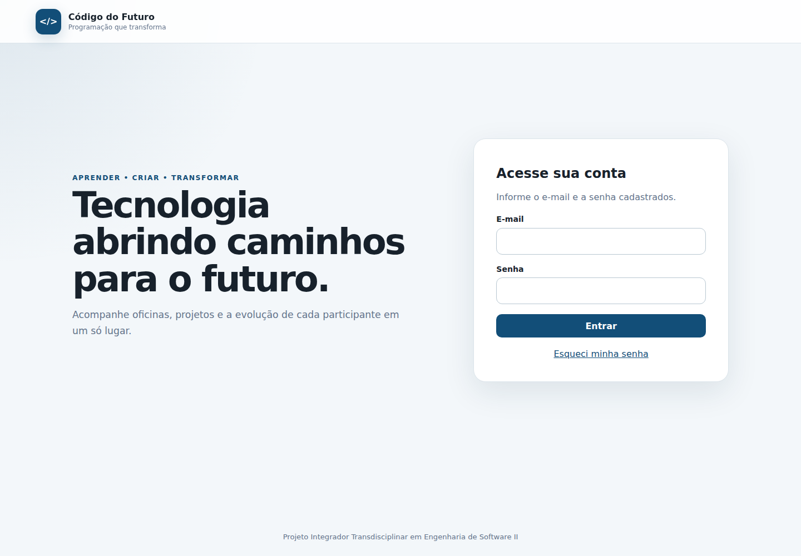

### Figura 3 — Meu perfil com nome e e-mail fictícios.

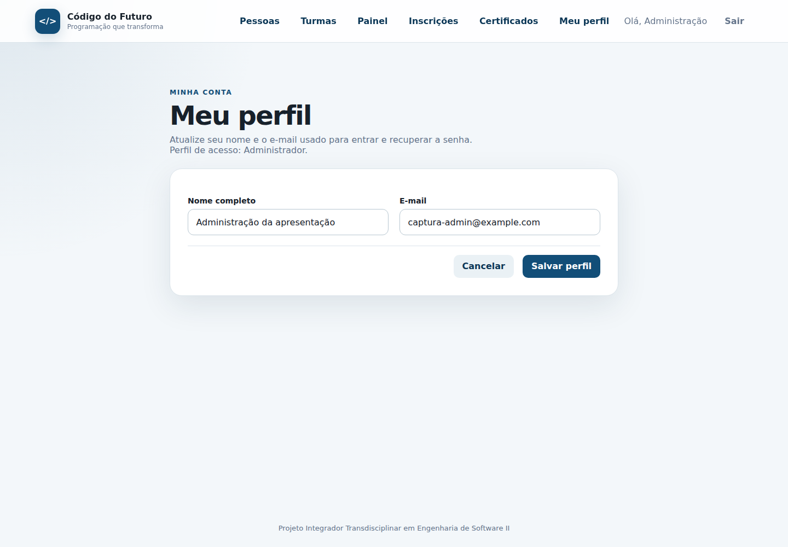

### Figura 5 — Ana, menor de idade, com responsável ativo vinculado.

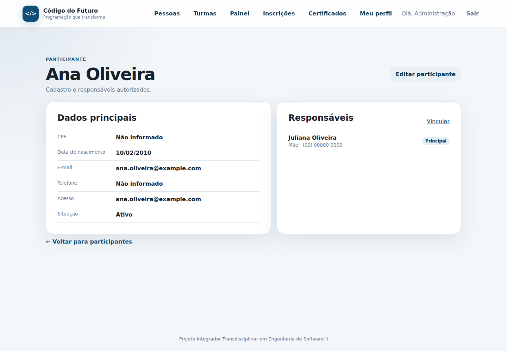

### Figura 13 — Web em andamento: encontros realizados e futuros coerentes.

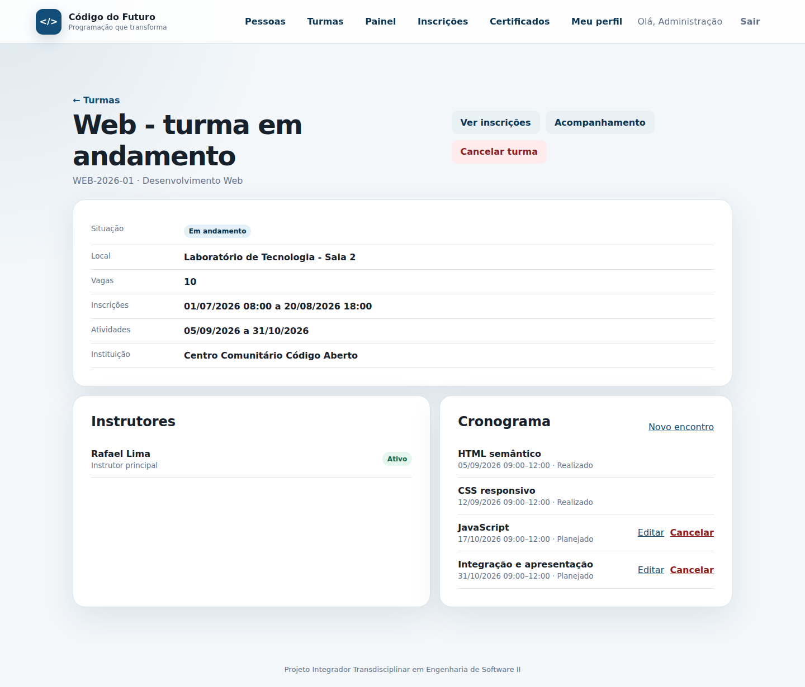

### Figura 15 — Capacidade 2; confirmadas 2; disponíveis 0; uma pendente e uma em espera.

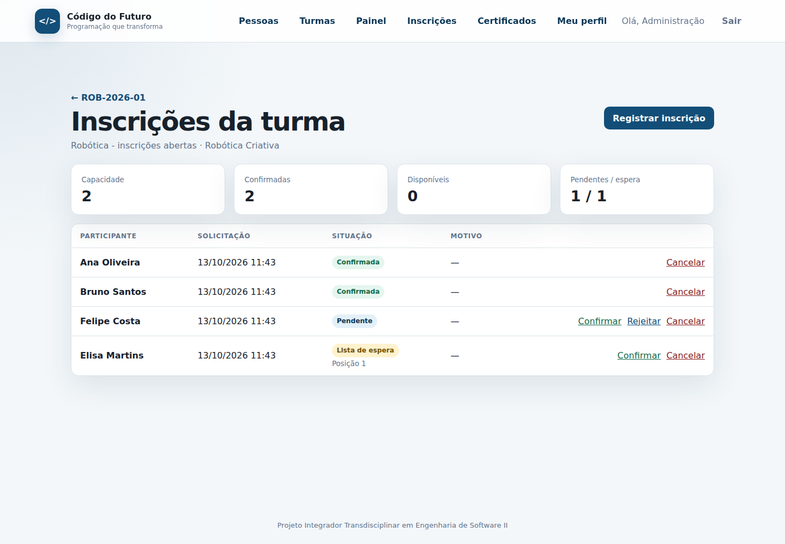

### Figura 16 — Carla com 100% e Diego com 50% nos dois encontros realizados.

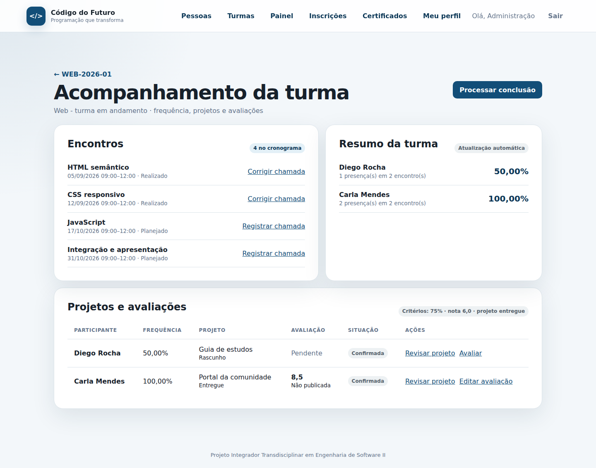

### Figura 19 — Ana aprovada; Bruno não concluinte por frequência 50%; critérios explicitados.

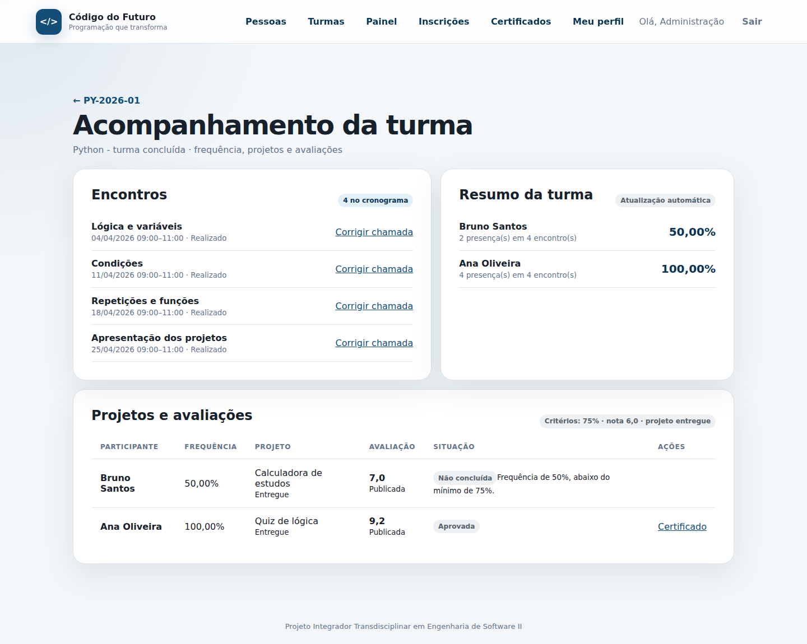

### Figura 20 — Certificado ativo de Ana: quatro encontros de 2h, total 8h.

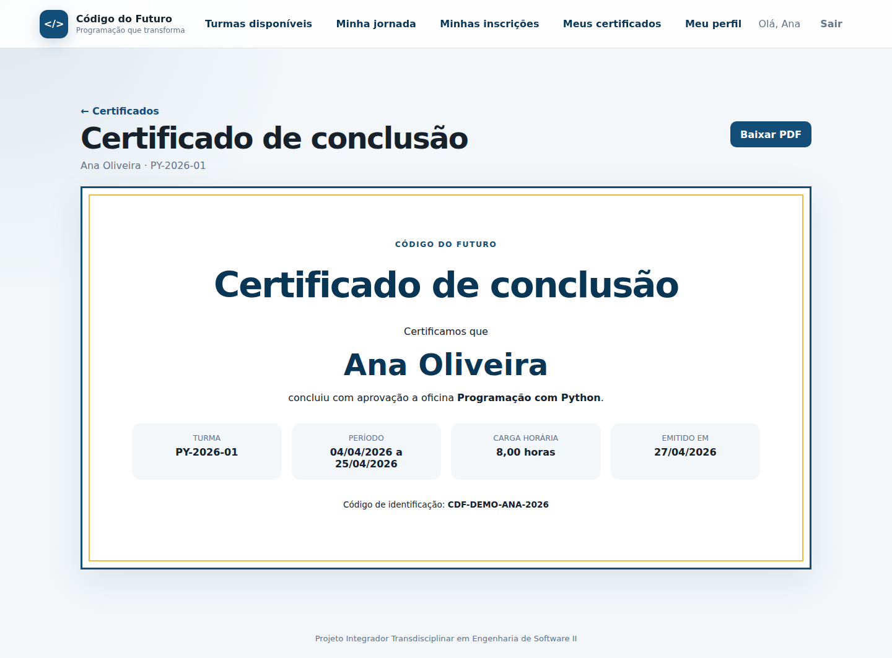

### Figura 27 — Universo: Python iniciado em abril; 1 turma, 2 participantes, 75% de frequência média e 50% de aprovação.

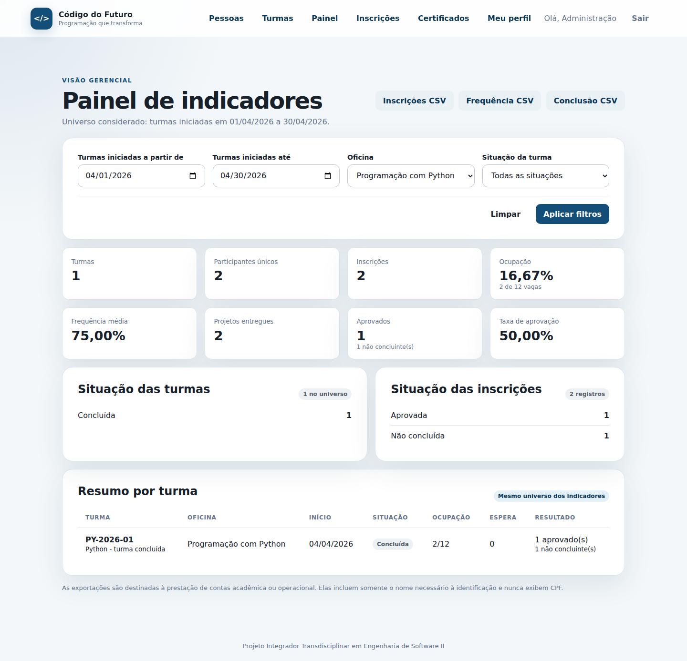

### Figura 28 — CSV realmente exportado, renderizado em visualizador HTML local; não é tela da aplicação nem Excel.

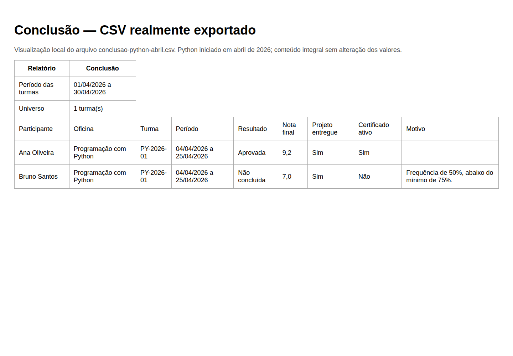

### Figura 29 — Página do PDF real de Ana, renderizada por PyMuPDF; 8h e código histórico preservados. Não é screenshot da interface.

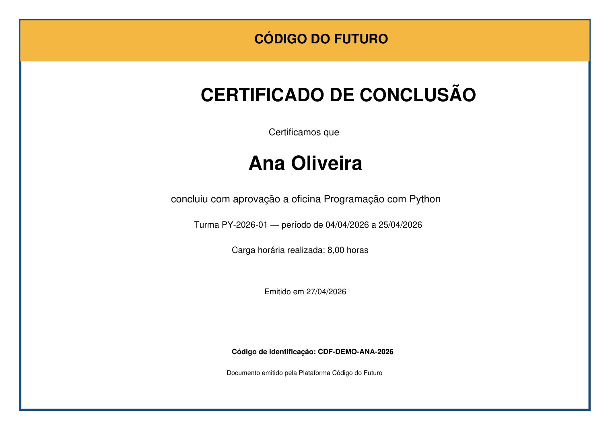

### Figura 36 — Jornada própria de Carla no celular.

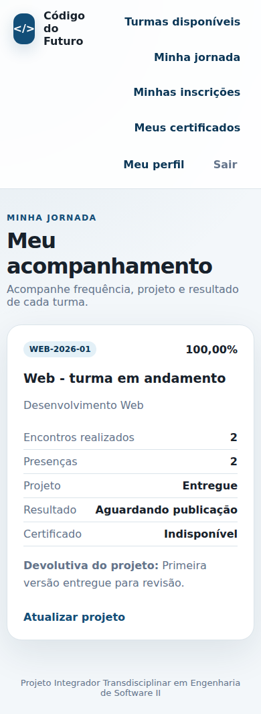
